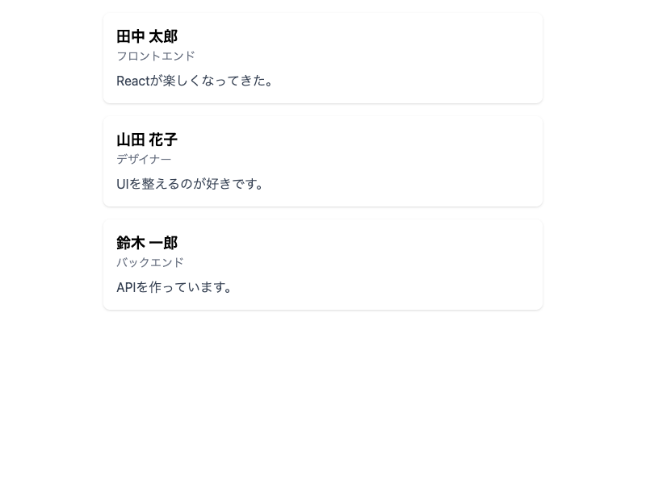

# 問題1：MemberCard を作って props を渡す（20分）

**このフォルダに作業ファイルはありません。** 自分の Vite + React プロジェクト（`my-bookshelf` をそのまま使っても、新しく作ってもかまいません）の中で作業してください。

チーム紹介ページ用に、メンバー1人分のカードを表示する `MemberCard` コンポーネントを作ってください。

**要件:**

- `src/components/MemberCard.jsx` に `MemberCard` を作り、`export default` する
- `name`（名前）・`role`（役割）・`message`（一言コメント）の3つの props を受け取る
- 名前を大きく（`text-lg font-bold`）、役割をグレー（`text-gray-500`）、コメントを通常のテキストで表示する
- `App.jsx` で `MemberCard` を `import` し、3回使って、それぞれ別のデータを渡す

**完成状態の確認方法:** ブラウザ（`http://localhost:5173/`）に3人分のカードが縦に並び、名前・役割・コメントがそれぞれ違って表示されていれば OK です。同じフォルダの **`goal.png`** と見比べてください。

ヒントと解答は、カリキュラムの Week14 → ミニドリル → 問題1 にあります。
