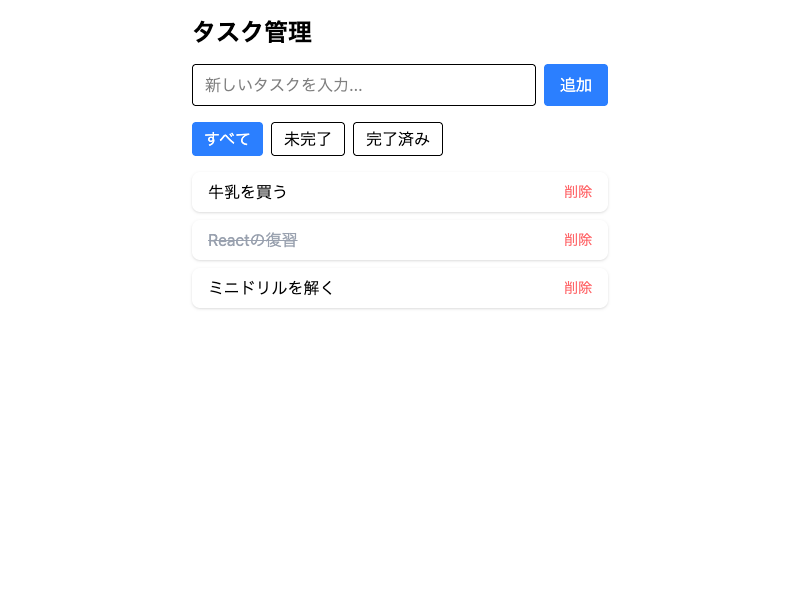

# 問題1：フィルター機能を追加する（20分）

**このフォルダに作業ファイルはありません。** 自分の Vite + React プロジェクト（`my-task-app` をそのまま使っても、新しく作ってもかまいません）の中で作業してください。

Week15 インプットの完成サンプル（タスク管理アプリ）に、「すべて」「未完了」「完了済み」の3つで絞り込めるフィルターを追加してください。

**要件:**

- `filter` という state（初期値 `"all"`）を追加する
- 「すべて」「未完了」「完了済み」の3つのボタンを表示する
- `filter` の値に応じて、表示するタスクを絞り込む（元の `tasks` は消さない）

**完成状態の確認方法:** ボタンを押すと、表示されるタスクが切り替わればOKです。「完了済み」を選ぶと、打ち消し線のついたタスクだけが残ります。フィルターを「すべて」に戻すと全部表示されることも確認してください。

同じフォルダの **`goal.png`** は「すべて」を選んでいる状態の見た目です。選択中のボタンだけ色を変えておくと、いま何で絞り込んでいるかが分かります。

ヒントと解答は、カリキュラムの Week15 → ミニドリル → 問題1 にあります。
